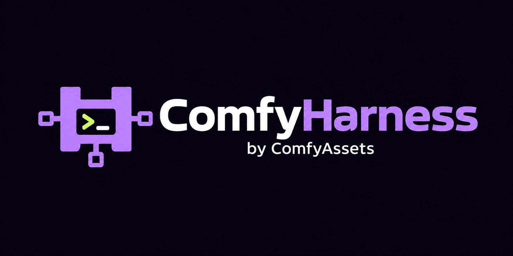
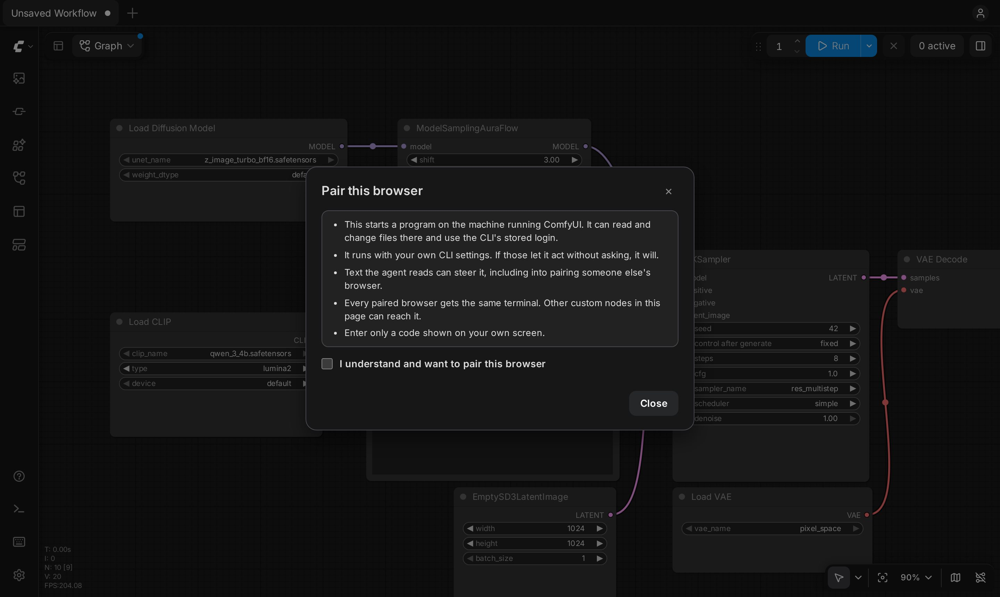
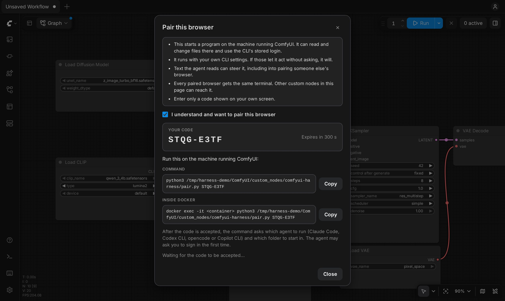
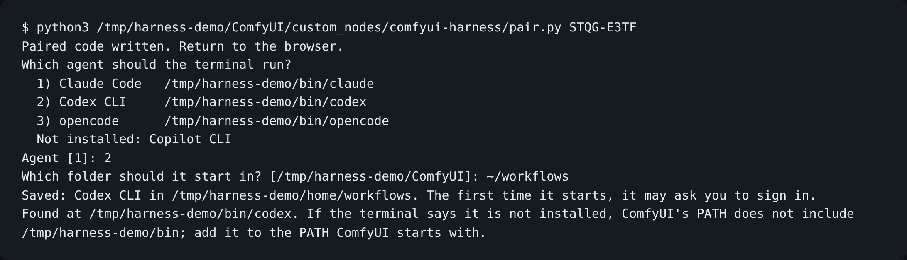
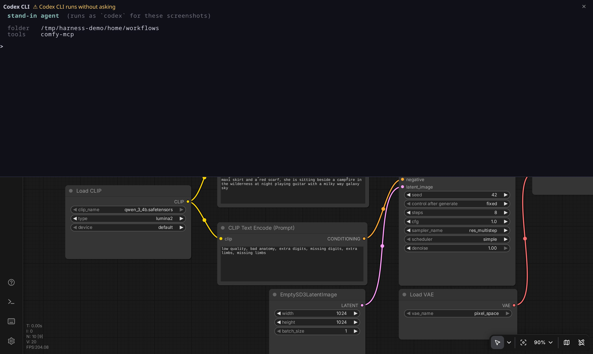
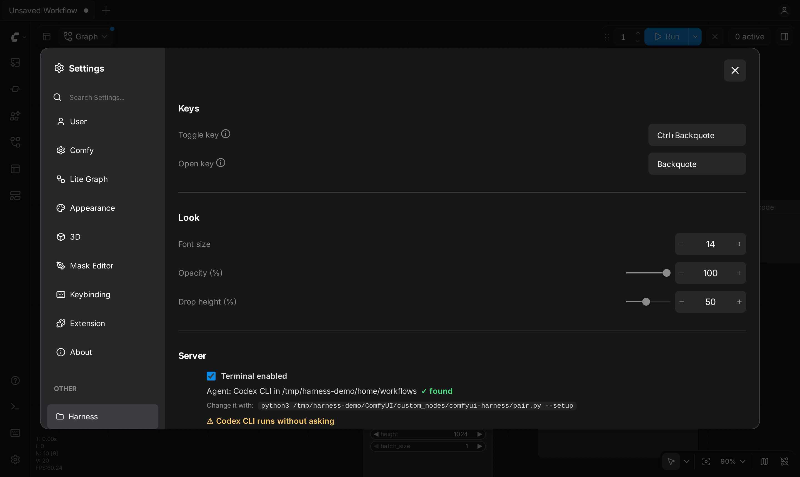
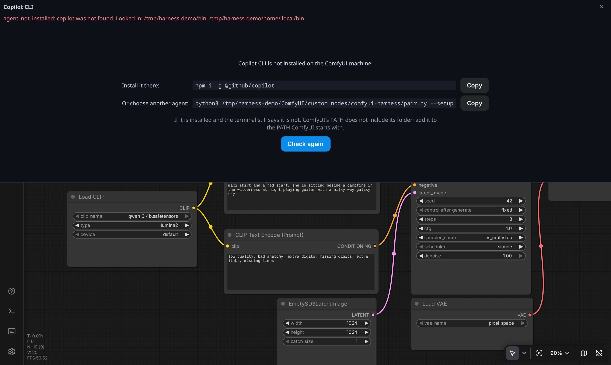

# ComfyUI Harness

**Your own coding agent, in a terminal that drops down from the top of the ComfyUI page.**

ComfyUI Harness is a ComfyUI custom node. Press the backtick key and a Quake-style terminal slides down over the canvas, running your agent CLI (Claude Code, Codex CLI, opencode or Copilot CLI) on the machine that runs ComfyUI. The agent gets ComfyUI's official MCP server (`comfy-mcp`) and, if you turn it on, a canvas bridge that lets it read and edit the workflow open in the page. You stop switching to a separate terminal, even when ComfyUI runs on another machine.

- **Bring your own agent.** It runs the agent, model and subscription you already have. The harness ships no agent, API key or model.
- **Every browser pairs.** A browser gets the terminal only after you confirm a one-time code on the ComfyUI machine. That includes a browser on the same machine.
- **Chosen on the machine.** Which agent runs, and in which folder, is set with `pair.py` on the ComfyUI machine. No browser can change it.
- **Optional canvas bridge.** When it is on, the agent can read the graph, edit it as one undo step per request, and press Run when you ask it to. It is off by default.

> [!IMPORTANT]
> The agent can do whatever the account that runs ComfyUI can do. Read [SECURITY.md](SECURITY.md) before installing.

## Onboarding

<table>
  <tr>
    <td width="50%" valign="top" align="center">
      <br>
      <sub><b>1.</b> Press the backtick key on the canvas. The first time, a popup says what the terminal can do, and you tick the box to go on.</sub>
    </td>
    <td width="50%" valign="top" align="center">
      <br>
      <sub><b>2.</b> It shows a code and the command to run on the ComfyUI machine, plain and inside Docker.</sub>
    </td>
  </tr>
  <tr>
    <td colspan="2" valign="top" align="center">
      <br>
      <sub><b>3.</b> <code>pair.py</code> accepts the code, then asks which installed agent to run and which folder to start in. Change it later with <code>pair.py --setup</code>.</sub>
    </td>
  </tr>
  <tr>
    <td width="50%" valign="top" align="center">
      <br>
      <sub><b>4.</b> The popup closes and the terminal opens with your agent, here Codex CLI. The header warns when the agent's own settings let it act without asking.</sub>
    </td>
    <td width="50%" valign="top" align="center">
      <br>
      <sub><b>5.</b> <b>Settings › Harness</b> shows the agent, its folder, whether it was found and the command that changes it.</sub>
    </td>
  </tr>
  <tr>
    <td colspan="2" valign="top" align="center">
      <br>
      <sub><b>6.</b> If the chosen agent is missing, the panel shows how to install it or choose another, and <b>Check again</b> looks without restarting ComfyUI.</sub>
    </td>
  </tr>
</table>

<p align="center"><sub>Taken in a throwaway ComfyUI. The agent in the terminal is a stand-in program, so the pictures show the harness and not a real agent's screen.</sub></p>

## Quick start

You need Linux, ComfyUI 0.45.0 or later, and one of the [supported agents](docs/agents.md) installed for the account that runs ComfyUI.

1. Install the node and restart ComfyUI:
   ```sh
   cd ComfyUI/custom_nodes
   git clone https://github.com/ComfyAssets/comfyui-harness.git comfyui-harness
   ```
   Optional: `pip install comfy-mcp` in ComfyUI's environment, for the agent's ComfyUI tools.
2. Open ComfyUI over HTTPS or on `127.0.0.1`, click the canvas and press the backtick key.
3. Tick the box, then run the command the popup shows on the ComfyUI machine:
   ```sh
   python3 /path/to/ComfyUI/custom_nodes/comfyui-harness/pair.py K7QM-3XVD
   ```
4. Answer the two questions: which agent, and which folder. The terminal opens.

The agent may ask you to sign in the first time it starts. Full steps, Docker and the rest are in [Getting started](docs/getting-started.md).

## Reaching ComfyUI from another machine

Pairing needs HTTPS, or a loopback address the browser trusts. There are three ways to get one:

- **Local:** open `http://127.0.0.1:8188` on the ComfyUI machine.
- **SSH port forward:** `ssh -N -L 8188:127.0.0.1:8188 you@gpu-box`, then open `http://127.0.0.1:8188` on your own machine. There is nothing to expose and no certificate to get.
- **Reverse proxy with HTTPS:** one address for every device. Caddy, Traefik and nginx examples get a Let's Encrypt certificate with the DNS challenge, so the proxy needs no open ports and works behind a VPN.

The commands and configs are in [Reaching ComfyUI](docs/remote-access.md).

## Documentation

| Document | What it covers |
|---|---|
| [Getting started](docs/getting-started.md) | Requirements, install, pairing step by step, changing the agent or folder, signing in, Docker, `comfy-mcp`, uninstalling. |
| [Supported agents](docs/agents.md) | The four agents, how each gets its MCP servers, how "continue" resumes, the "runs without asking" check, and why others are not supported. |
| [Reaching ComfyUI](docs/remote-access.md) | Local use, SSH port forwards, and a reverse proxy (Caddy, Traefik, nginx) with Let's Encrypt over the DNS challenge. |
| [Using the terminal](docs/terminal.md) | Keys, sessions, every setting, and the popup's text. |
| [Canvas bridge](docs/canvas-bridge.md) | Letting the agent read, edit and run the open workflow, and the three switches. |
| [Playwriter](docs/playwriter.md) | Optional: letting the agent drive your own Chrome tab. |
| [Troubleshooting](docs/troubleshooting.md) | Every error code and panel message, what to do, and the current limitations. |
| [Security](SECURITY.md) | The threat model: what pairing protects, what the agent can do, and how to report a problem. |
| [Testing](TESTING.md) | Running the test suites, for development. |

## License

[MIT](LICENSE)
